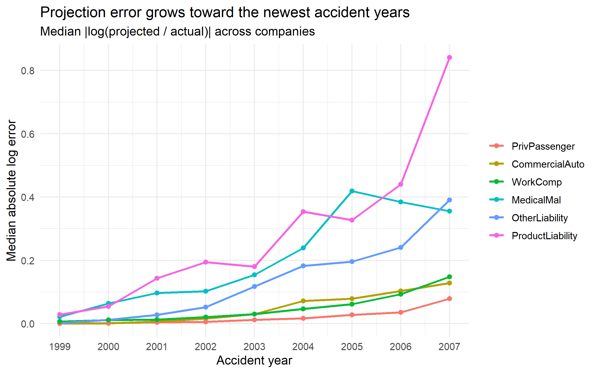
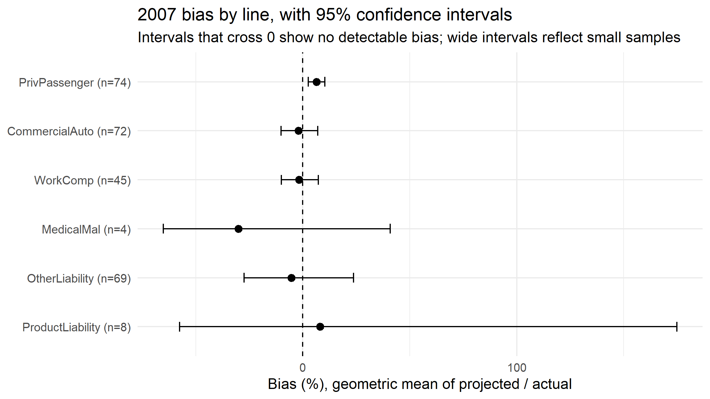
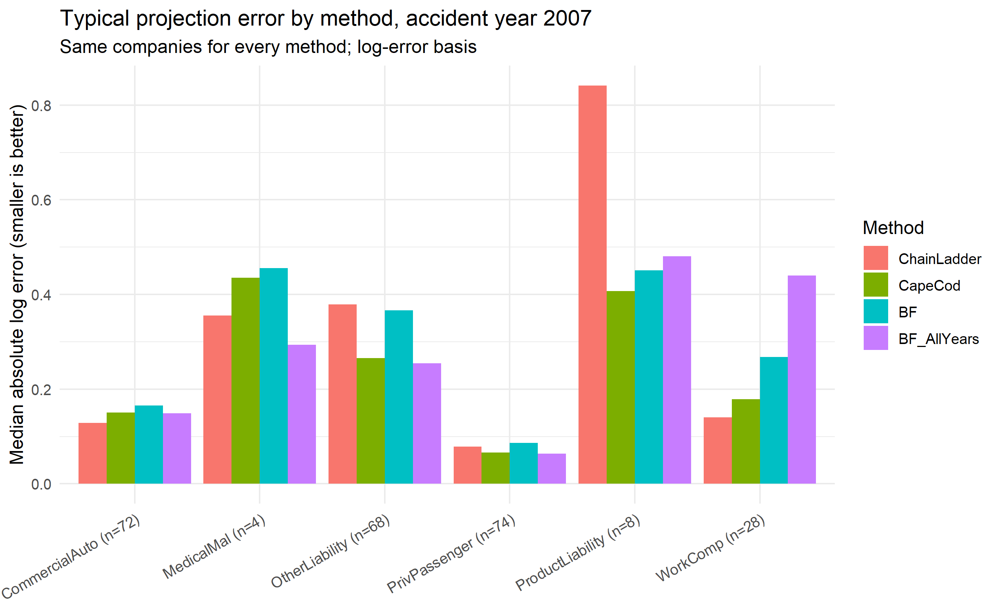
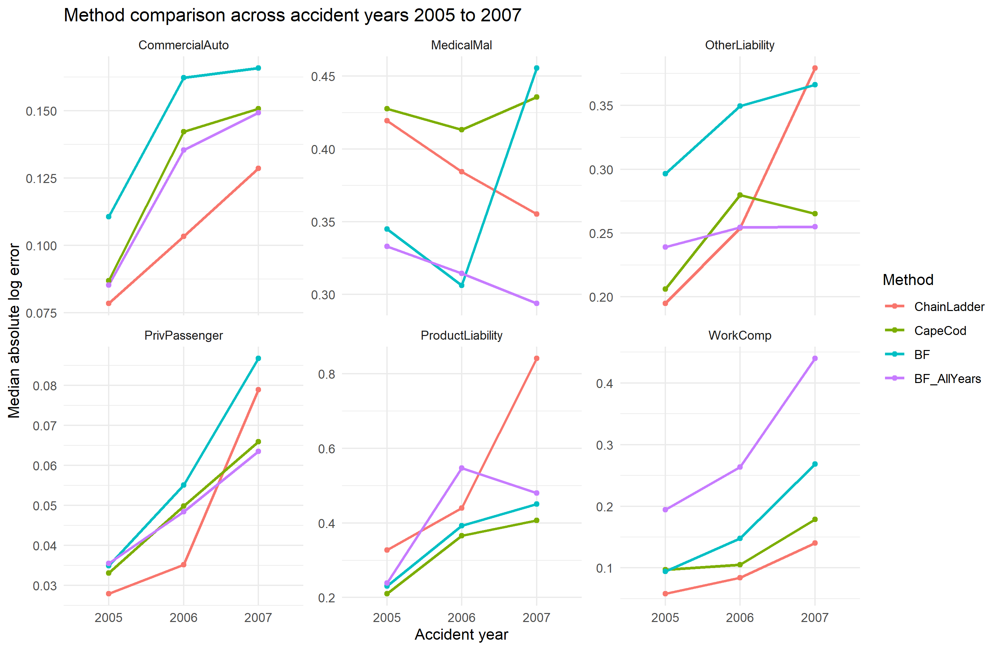
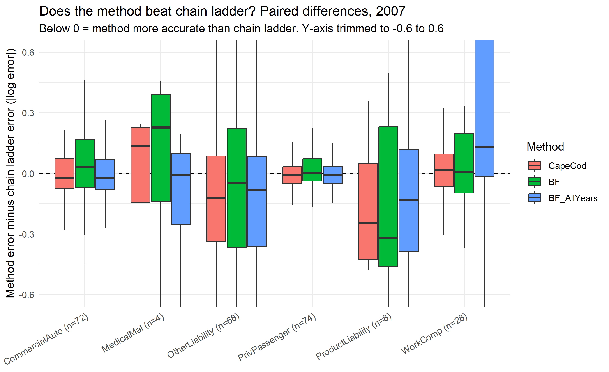

Backtesting Chain Ladder Reserves Across Lines of Business
-
The Chain Ladder Method has always been a staple for Insurance Reserving, but how well does it compare to the actual claim payments? Using the CAS Loss Reserving Data Base which includes data from the NAIC Schedule P Filing I was able construct paid-loss triangles up until the end of 2007 for the six lines of business and predict each companies Lag 10 losses as well as backtesting these predictions with the actual reported losses. On average for this data, the chain ladder method showed little projected bias with private passenger auto lines being the only detectable exception to this showing approximately 6% overprojection. All together, predictions by the accident year 2007 differed significantly by line: typical misses for private passenger being about 8%, 14% to 16% for  commercial auto and and worker's compensation, and about 48% for other liability. Medical Malpractice and Product Liability had far too few lines (4 and 8 respectively) to support firm conclusions. I then performed Bornhuetter-Ferguson and Cape Cod tests in order to look into how the premium data may affect these predictions. After adjusting for multiple conclusions, tests were largely inconclusive, although Cape Cod ended up showing some benefit in other liability lines. It is important to note that these results are from a filtered sample, the 25th percentile of smallest companies by net premium were filtered out, so these findings are meant to support larger companies rather than the entire industry.

Data: Meyers and Shi, 2011, https://www.casact.org/publications-research/research/research-resources/loss-reserving-data-pulled-naic-schedule-p

Methods:
- 
- Filtered data by positive claim payments and 25th percentile of net premiums across lines
- Preformed volume-weighted Chain Ladder Analysis on paid losses with tail factor of 1.0
- Triangles were cut by 2007 and backtested against actual lag 10 values
- Moved percent error to log error since percent error was distorted by the actual lag 10 claim payments for specific lines

Results:
- 

|   |Line             |  N| Pct_Bias| Typical_miss_pct|
|:--|:----------------|--:|--------:|----------------:|
|9  |CommercialAuto   | 72|    -1.94|             13.7|
|18 |MedicalMal       |  4|   -30.03|             42.6|
|27 |OtherLiability   | 69|    -5.27|             47.8|
|36 |PrivPassenger    | 74|     6.38|              8.2|
|45 |ProductLiability |  8|     8.05|            131.9|
|54 |WorkComp         | 45|    -1.77|             16.0|

*Median absolute log error by line and accident year. Error grows toward the newest years. Log-error basis, accident year 1998 excluded.*

*Bias by line for accident year 2007, with 95% confidence intervals (log-error basis, geometric mean of projected / actual). Intervals that cross 0 show no detectable bias. Medical malpractice (n=4) and product liability (n=8) have very wide intervals because of small samples.*

Method Comparison
-
In general, the chain ladder method is the least reliable for performing analysis on newer accident years because accumulation factors tend to be sensitive to the most recent payments. This is why I decided to perform perform further analysis by utilizing the Bornhuetter-Ferguson and Cape Code methods which blend in an expectation based premium, so I tested whether these methods improve projections.

Here is a quick overview of each method:
- Chain Ladder: projects each accident years cumulative loss by multiplying the latest cumulative paid loss by a cumulative development factor using the claims data.
- Cape Cod: keeps the latest paid loss and incorporates and estimate of the unpaid portion based on premium , utilizing an expected loss ratio estimated from each companies own data
- Bornhuetter-Ferguson: Keeps the same overall structure as Cape Cod, but the expected loss ratio is based upon the prior three oldest accident years

The design for this analysis incorporated the same data from the chain ladder analysis with the paired tests by company (Wilcoxon signed-rank, and Holm-adjusted), but both of these tests positive net premiums so workers comp data ended up dropping from 45 to 28 companies and other liability from 69 to 68 companies. Numbers differ from chain ladder results due these changes. 

Method Comparison Results
-
Neither of the two methods ended up differing significantly from the original analysis, although were some findings that are worth noting:
-  Perhaps strongest, Cape Cod had a lower typical error for about 63% of companies (median difference -0.12 in absolute log error; raw p = 0.006, adjusted p = 0.19). BF with all-years prior was similar (62% of companies; raw p = 0.007, adjusted p = 0.22). It is important to note these results are suggestive and not inclusive
-  On the other hand, Bornhuetter-Ferguson with all years prior for workers compensation was worse than chain ladder (better for only 32% of companies; raw p = 0.004, adjusted p = 0.15) while standard Bornhuetter-Ferguson and Cape Code were similar to chain ladder
-  Commercial auto and  private passenger auto showed no difference
-  Bornhuetter Ferguson depends on its prior, switching from three oldest to all years prior made it much worse in workers comp, where loss ratios appeared to contrast over time
-  Medical malpractice and product liability are still descriptive only as they are small sample sets

*Median absolute log error by line and method for accident year 2007 (smaller is better). Every method uses the same companies, so workers' comp covers 28 companies and other liability 68. Medical malpractice (n=4) and product liability (n=8) are descriptive only.*

*Median absolute log error by line and method for accident years 2005 to 2007. Premium-based methods' advantage in some lines appears mainly in 2007.*

*Each company's absolute log error under a method minus its error under chain ladder, 2007. Values below 0 mean the method was more accurate. The y-axis is trimmed to -0.6 to 0.6, so some extreme values are cut off.*

Limitations:
- 
- Chain Ladders only include lag 10 values which understates ultimate payments for long-tailed lines
- Incurred Losses were not included and only used to filter data
- Negative and zero paid and incurred data as well as 25th percentile of net premiums were filtered out
- 2007 was the only evaluation data used
- Log Error T-tests assume normal errors, so Wilcoxon Tests were run
- Companies preform business across several lines so p-values should be rough guidelines for bias
- Bornhuetter-Ferguson and Cape Cod methods reduced workers comp to 28 from 45 companies in chain ladder analysis
- Bornhuetter-Ferguson method tends to perform closer to Cape Cod because both methods used expectation from the same premiums

Note: AI assistance was used for code generation, selected calculations were checked by hand in order to verify results
